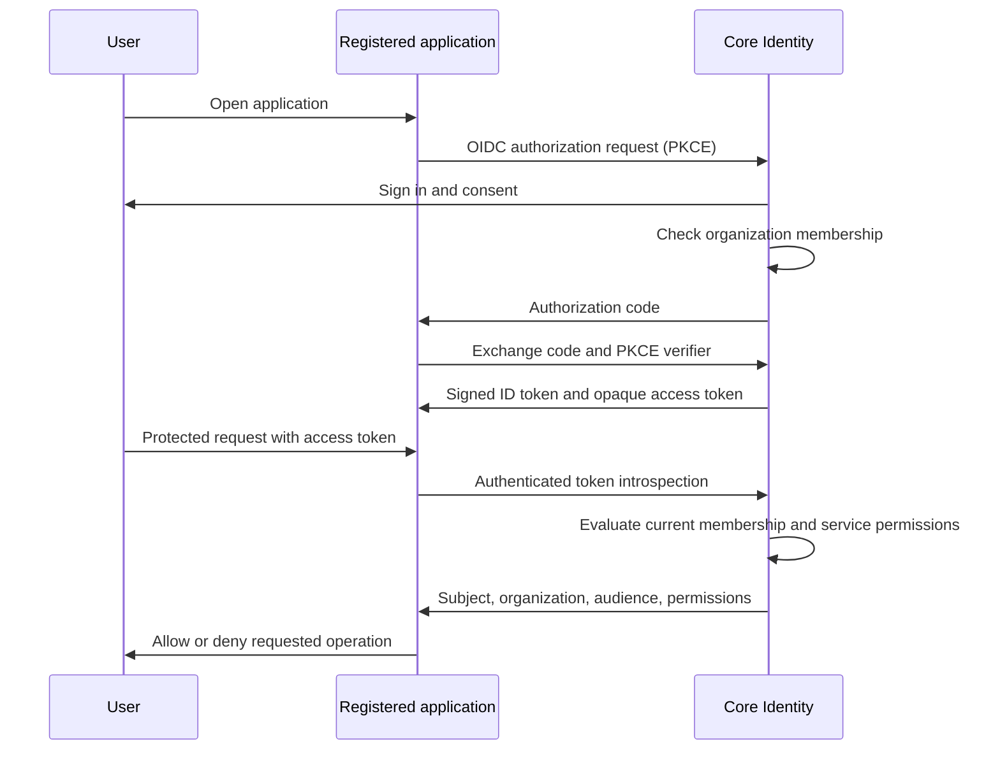

# Core Platform

NCE_Core hosts **Core Platform**, an organization control plane with identity,
authorization, a marketplace, core data services, chat, agents, workflows, and Kubernetes
instance management.
Customers can rename it for their deployment or individual organizations. The
product name is cosmetic; the configured issuer URL and immutable organization,
user, and service identifiers establish trust.

The implementation uses Django and Django OAuth Toolkit. Identity is established
in this deployment and federated to applications through OpenID Connect/OAuth 2.0.
Organizations can also broker sign-in from Keycloak, cloud identity providers,
another Core deployment, or another compatible OIDC provider. Explicit subject
links keep Core memberships and permissions authoritative.
Applications consume the core services over authenticated HTTPS APIs, wherever
they run. Marketplace deployments receive organization-bound configuration,
OIDC registration, and workload credentials automatically.

## Core services and central administration

[Development operations](docs/development-objects.md) provides versioned, composable
connections, pipelines, data fusions, ML models, agents, and cross-application workflow
graphs through Core Workflows. Review and share recipes in Central admin → Development
operations; local experiments retain source permissions, central quotas, model metrics,
and pinned lineage. Applications and AI agents use `development_client.py`; portable
imports require local resource bindings and fresh administrator review.

The marketplace supplies **Core Platform**, **Core Data**, **Core Agents**,
**Core Workflows**, **Core Chat**, **Core Training**, **Core Data Fabric**, and **Core App Factory** alongside application packages.
Core packages currently execute inside the core runtime; each organization receives its own installation, service
identity, permission settings, and monitored instance. The central panel manages
members and roles, application grants, runtimes, deployment state and health,
datasets, pipelines, agent definitions, and workflow runs.

[Application integrations](docs/application-integrations.md) publish shared
contracts and environment-scoped connections with explicit app inheritance and
live RBAC. App admin panels can use delegated settings APIs; the portable adapter
also supports independently configured standalone applications.

The optional [shared organization header](docs/unified-header.md) includes
permission-checked app links, personal pins, account tools, and a Chat drawer
with unread notifications. Administrators customize logos, names, colors, widget
order/visibility, shared app shortcuts, and permission-tagged organization links
in a live preview editor, with organization defaults and app overrides.
Native Core and newly generated apps include it; existing apps use
the browser component and same-origin backend adapter.

[Core AI](docs/central-ai.md) provides unified, cited retrieval across application datasets
and bilaterally approved deployment federation. Users and consuming applications retain
their live roles, tags, and environment boundaries. The conversational workspace performs
bounded literal search without API keys; model generation stays inactive. Implementation
tasks and ownership are recorded in [the Core AI task list](docs/tasks/central-ai.md).

[Core AI rules](docs/ai-rules.md) compose inherited budgets and query constraints, enforce
shared user/agent quotas across apps, and monitor reserved/reported spend centrally.
Paid operations start disabled; no provider is called by the rules service.

[Organization documentation](docs/organization-documentation.md) inherits versioned
application guides into each organization's platform, with local extensions/replacements,
environment/deployment context, live permission checks, and Markdown/JSON/JSONL retrieval
for humans and AI. App Factory releases include application-specific guides automatically.

[AI application creation](docs/app-factory.md) turns reviewed descriptions/specifications
into executable data applications through six scoped development-agent accounts. Generated
services inherit Core login, live authorization, collection tags, and audit/accounting controls.
Source review, test execution, and an approved image digest precede marketplace release.

Core Training supplies an [AI-first simulation and evaluation harness](docs/training.md),
with synthetic pipeline data, agent workflows, seeded scenarios, and attributed reviews.

Core Data Fabric supports [bilaterally approved data federation](docs/data-fabric.md)
between independent deployments, with scoped reads/writes and live permission checks.
Start with [the local testing walkthrough](docs/local-testing.md) to run it on your Mac.

The [iOS/Android architecture review](docs/mobile-architecture.md) and
[sequential mobile delivery playlist](docs/tasks/mobile-delivery.md) define native
hosts around the same shared UI. The shared mobile UI foundation is implemented;
native authentication, app projects, device validation and store releases remain
ordered future tasks. Stores distribute the app packages; Core's backend remains
on the organization's server.

Core Data validates JSON records, applies select/rename transformations, accepts
idempotent events, and exposes cursor-based consumption. Core Agents includes
inspect, select, publish, and bounded rule-based tool selection. Core Workflows
persists agent snapshots, execution leases, step traces, and retries. Each agent
has its own [account and marketplace approvals](docs/agent-accounts.md). Workers
recheck both the submitter's and the agent's current permissions before every step.
These initial agents use deterministic rules; no paid model provider is enabled.

The outbound Kubernetes connector reconciles approved, digest-pinned application
images into an existing namespace and reports actual rollout health. The controller
appears in its own inventory; an existing Kubernetes controller can be adopted for
monitoring and rolling restart. Automatic application deployment is an onboarding
setting, disabled by default. Creating clusters, purchasing infrastructure, and
charging payments are outside this implementation.

See [Kubernetes modernization and environment isolation](docs/modernization.md)
for adopting existing applications into segregated sandbox, development and
production environments.

See [the platform guide](docs/platform.md) for onboarding, marketplace publication,
Kubernetes connection, and the core API contract.

## Access model

| Principal | Core Identity controls | Deployed application controls |
| --- | --- | --- |
| Organization administrator | Own organization's users, invitations, roles, branding, services, and client registrations | `admin` and every registered permission for each service in that organization |
| Organization member | Own account and password | Permissions explicitly assigned through custom organization roles |
| Platform superuser | Deployment-level organization and account administration | Requires an organization membership to obtain a token for that organization's services |
| Confidential application client | Introspection of tokens for its own service | Does not receive a human user's administrator privileges |

A user can belong to several organizations with different roles in each. Every
OAuth client belongs to exactly one service, and every service belongs to one
organization. Sign-in takes its organization from this registration, never a
caller-supplied tenant claim. Organization administrators are not Django staff or
platform superusers.

Custom roles group permissions such as `read` and `reports-edit`. Permissions are
defined per service. The reserved `admin` permission comes only from the built-in
organization administrator role. Unknown permission names are denied, including
for administrators.

Permission tags add resource requirements and explicit access grants, verified
MFA, recent authentication, purpose codes, and workload restrictions. Tags apply
through the portal, OAuth authorization, core APIs, and workflow execution;
administrators must satisfy them too. Application-owned records can register
their resource policy centrally. See [identity and security configuration](docs/security.md)
for provider setup, enforcement rules, audit export, and compliance preparation.

Organizations are logical tenants in a shared database. Deployed services must
also scope their own data queries and administration to the trusted organization
ID. This service does not change permissions in applications that have not
integrated with it.

## Run locally

Python 3.12+ and [uv](https://docs.astral.sh/uv/) are required. In this checkout:

```sh
uv sync --frozen
uv run python scripts/init_dev.py
export CORE_DEBUG=1
uv run python manage.py migrate
uv run python manage.py bootstrap_organization \
  --slug example --name "Example Organization" --admin-email admin@example.com
uv run python manage.py changepassword admin@example.com
uv run python manage.py runserver 127.0.0.1:8000
```

Run the durable workflow worker in a second terminal:

```sh
CORE_DEBUG=1 uv run python manage.py core_worker
```

Development uses SQLite and unique local secret files generated once under the
ignored `.local/` directory. No default account or password is installed. The
bootstrap command is an operator command, not a public signup endpoint; repeat
runs preserve existing memberships and accounts. The password command validates
password strength and prompts without storing a password in command history.

Sign in through `/accounts/login/`. Organization administrators can invite users,
assign roles, register services, and register confidential or public application
clients. Invitations expire after 48 hours and are single use. The administrator
shares the invitation link securely; email delivery is not implemented. Existing
users must sign in to the matching account to accept an invitation. New users
choose their own password.

Set `CORE_PRODUCT_NAME` to change the deployment's default name. Each organization
can override it under Organization settings. Platform operators can create a
separate superuser with `manage.py createsuperuser` for `/platform-admin/`.

For developer onboarding, the platform operator creates an ordinary user in the
platform account administration and grants `is_developer`, or uses
`manage.py grant_developer user@example.com` for an existing account. Its next
sign-in opens a resumable five-step organization, metadata, billing preference,
deployment, and runtime setup. The developer becomes administrator only of the
organization they create. `CORE_DEBUG` and URL parameters do not grant this status.
For an organization provisioned with the bootstrap command instead, install the
core packages from its Marketplace link.

## Federate sign-in and authorization

See [the integration guide](docs/integration.md) for the complete contract and
examples. An application uses OpenID Connect Authorization Code with PKCE S256.
Its user signs in through the central Core Identity deployment. The existing
central session allows subsequent applications to reuse sign-in; each application
gets its own service-bound authorization context and consent.



Core Identity exposes:

| Endpoint | Purpose |
| --- | --- |
| `/.well-known/openid-configuration` | OIDC discovery and fixed issuer |
| `/.well-known/oauth-authorization-server` | OAuth server metadata |
| `/oauth/authorize/` | Browser authorization and consent |
| `/oauth/token/` | Code exchange and rotating refresh tokens |
| `/oauth/jwks/` | Public signing keys |
| `/oauth/userinfo/` | Scope-limited identity and current authorization claims |
| `/oauth/introspect/` | Authenticated, service-bound token introspection |
| `/oauth/revoke/` | OAuth token revocation |
| `/api/v1/authorize/` | Central permission decision for a token and organization |
| `/health/` | Database connectivity readiness check |

ID tokens authenticate a user to their registered client. Access tokens authorize
resource requests. Services use live introspection or the authorization endpoint
for privileged operations; an ID token's role snapshot cannot establish current
authorization. Membership disabling, role removal, client disabling, and service
disabling take effect on the next central check. Identity outages deny access.

An application written in any language can use these protocols. The
framework-independent [reference client](identity_client.py) and
[protected service example](examples/protected_service.py) show server-side
enforcement. Public clients need a confidential backend registration in the same
service for introspection. Keep all confidential client secrets on the backend.

## Validate

[The chat guide](docs/chat.md) covers the native chat UI, application API/SDK,
permission-tagged conversations, shared history across trusted Core instances,
and explicitly authorized AI messaging tools.

[The CI/CD guide](docs/cicd.md) defines the shared PostgreSQL test, container build,
registry publication, and Kubernetes release pipeline, with adapters for GitHub
Actions, GitLab CI, Azure Pipelines, Jenkins, CircleCI, Bitbucket, and AWS
CodeBuild/CodePipeline. Execution is manual and external release steps default off.

```sh
CORE_DEBUG=1 uv run python manage.py test identity.tests platform_services.tests core_chat.tests core_fabric.tests
CORE_DEBUG=1 uv run python manage.py makemigrations --check --dry-run
```

Tests exercise signed OIDC tokens, PKCE, service and organization isolation,
multi-organization membership, live permission changes, token revocation and
refresh replay protection, invitations, administrative CSRF, and the reference
resource service, upstream OIDC exchanges, account-link isolation, MFA evidence,
tag enforcement, audit preservation, core APIs, data ingestion, durable workflows, onboarding,
deployment lifecycle, and tenant isolation. The same suite can run against
PostgreSQL by setting `DATABASE_URL`. The GitHub Actions workflow uses PostgreSQL
and is manual-only, with an existing self-hosted runner by default, so pushes do
not start potentially billable jobs. A separate
opt-in test verifies real reconciliation against a disposable local kind cluster;
see [the platform guide](docs/platform.md#validation).

Deployment instructions and configuration are in [docs/deployment.md](docs/deployment.md).
The repository contains the initial implementation; it has not been deployed to
a customer environment. Upstream provider credentials and MFA assurance mappings
must be configured per organization. Native MFA enrollment, account recovery/email
delivery, OAuth client-credentials grants, and OAuth token exchange are future additions.
Billing adapters for Stripe, Paddle, Adyen, and Braintree are inactive stand-ins.
Machine-to-core access currently uses scoped, revocable workload credentials.
The current SSO model uses a fresh, service-specific code exchange for each
application, rather than forwarding a token to unrelated services.
