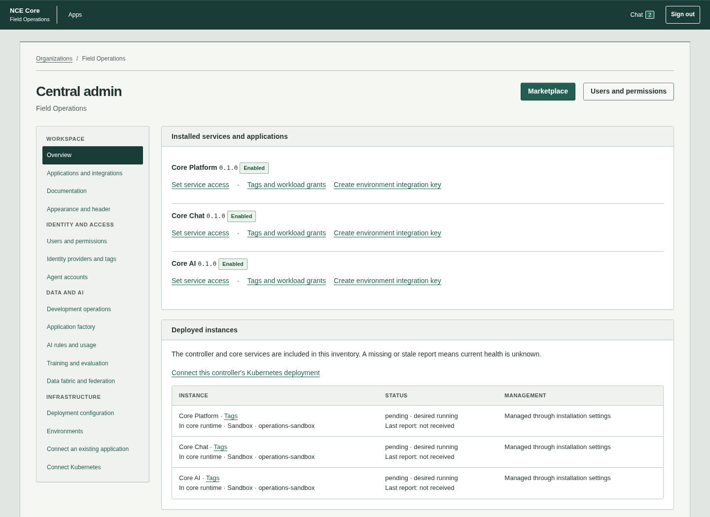
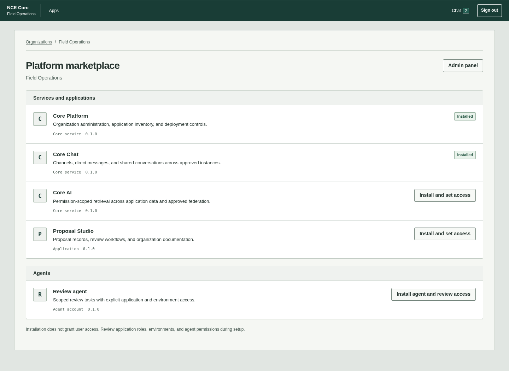
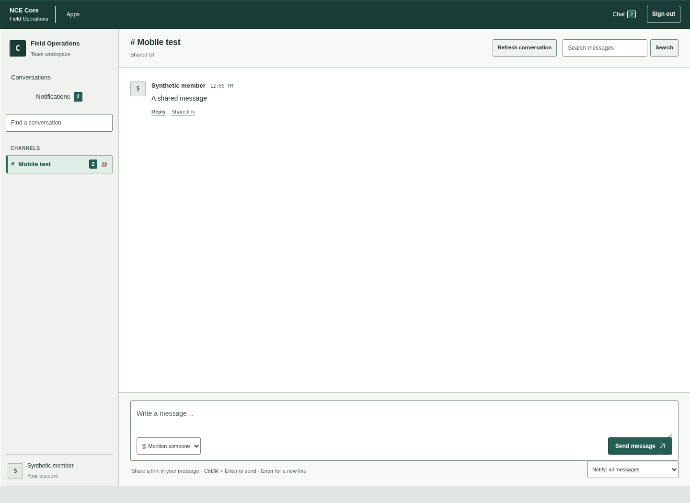

# Core Workbench design system

Workbench is the shared visual language for Core's operating surfaces. It uses
mineral-gray chrome, dark teal title bars, ruled panels, compact navigation,
square badges, and restrained raised/inset edges. Desktop-software structure
provides the Windows 95 influence; responsive layouts, live permissions, scoped
AI tools and accessible controls provide the current behavior.

The interface presents records, actions, access and state. Use direct operational
labels and factual help. Empty states explain the next available action. Avoid
marketing slogans, oversized hero headings, ornamental gradients, floating pill
navigation and decorative metrics. An AI capability should appear as a usable
tool with its actual state and scope, rather than a visual claim about intelligence.

## Shared implementation

The canonical stylesheet is
[design-system.css.html](../templates/identity/design-system.css.html). It contains
plain CSS and tokens, so Django includes it directly and App Factory bundles the
same source into a standalone application's `ui.css`. No remote fonts, assets,
framework or model provider are required.

| Foundation | Tokens and use |
| --- | --- |
| Typography | `--core-font`: local Segoe UI/system fonts; `--core-mono`: local monospace for identifiers, versions and accounting. Body 14px, page title 28px, panel title 14px. Phone form fields remain at least 16px. |
| Surfaces | `--core-canvas`, `--core-surface`, `--core-chrome`, `--core-chrome-raised`: workspace, content, title/tool bars and controls. |
| Text and lines | `--core-ink`, `--core-muted`, `--core-line`, `--core-control-line`: legible text, separators and visible input boundaries. |
| Actions and state | `--core-title`, `--core-action`, `--core-action-hover`, `--core-selection`, `--core-focus`, `--core-danger`: specific functional roles. Do not use color as the sole status indicator. |
| Geometry | `--core-radius`: 3px; `--core-edge`: subtle light/shadow edges; `--core-space-1` through `--core-space-6`: 4, 8, 12, 16, 24 and 32px. |

[Mobile foundation](../templates/identity/mobile-foundation.css.html) and
[accessibility styles](../templates/identity/accessibility.css.html) load after
page-specific styles. They retain safe areas, readable phone fields, 44px mobile
buttons, visible focus, keyboard scrolling and forced-color/reduced-motion support.
Do not override these requirements with a workspace stylesheet.

## Composition

- `page-heading` contains the page's single primary heading, factual context and
  a small set of actions. `workspace-path` identifies the current organization;
  it is context, not an access grant.
- A `section` or `panel` has a thin frame and a compact first-child `h2` title
  strip. Keep long documents and data in their normal reading flow.
- `button` is the primary action. An anchor styled with `button` navigates;
  a real button submits or performs an action. `secondary` marks an alternate
  action with neutral raised chrome. Preserve semantic elements and labels.
- `table-scroll` contains a table when its data requires horizontal scrolling.
  Keep column headers/captions and a named region. Progressive keyboard support
  adds a tab stop only when the region actually overflows.
- `status-label` displays a textual state; `active` marks an enabled/installed
  state. Installation enabled status is not deployment health. Never invent
  online indicators, usage totals or successful outcomes.
- `admin-layout` groups administration navigation beside operational content.
  At narrow widths it becomes a single column with grouped navigation.
- `catalog` and `catalog-row` display application/agent records with metadata
  and an explicit install/access action. On phones the action moves below its
  record. A catalog listing does not grant permission.
- `auth-window` uses a restrained title bar and inset fields. Account/provider
  sign-in behavior and error summaries remain independent of presentation.
- `query-layout` separates the query form from its actual retrieval capabilities.
  Evidence retains source/application/environment attribution and live policy.
  Model generation remains unconfigured; styling does not enable it.

Chat shares the palette, form treatment, title strips, message typography and
compact notification badges. Its conversation history and composer remain
workspace-specific. On a phone, conversations become a horizontal list and
the document can scroll to keep the composer reachable. The shared header's
Shadow DOM has corresponding component styles for independently hosted apps.

## Organization appearance and application inheritance

Open **Central admin → Appearance and header** and select **Workbench** in
the color-scheme field, review the preview, then save. Workbench is the default
for unconfigured headers. Existing saved presets/custom colors, logos, widget
order, shortcuts and access policies continue to apply. Other presets remain
available; custom colors retain the existing contrast validation.

The header color configuration controls header branding. Portal surface tokens
provide a consistent surrounding workspace and are not arbitrary executable
organization CSS. Existing applications can adopt the shared header through
the [header integration](unified-header.md). Newly built App Factory source
archives include the canonical Workbench stylesheet; already released external
images require their own reviewed rebuild/release to update their application UI.

To see the updated portal on your Mac, pull `main`, stop your existing web process
with Ctrl-C, and restart it from the checkout:

```sh
git pull --ff-only origin main
uv run python manage.py dev
```

Use your existing local keys, account and database. See
[local testing](local-testing.md) for initial setup and the worker process.
This styling update has no database migration and does not deploy external images.

## Browser previews and verification

The previews below render the real templates/component in local Chromium with
synthetic records. They do not represent a live customer's data or deployment
health. Application/service names and states are fixture values.







Verification uses the existing actual-browser keyboard/mobile/axe suites,
populated admin and environment fixtures, configurable-header tests, Chat/AI
portal authorization tests and generated source/runtime verification. Run the
browser suites using the instructions in [accessibility](accessibility.md).
Automated results are engineering evidence; device/assistive-technology review
remains part of [mobile delivery](tasks/mobile-delivery.md).

Verification on 10 October 2026 passed 20 browser/presentation tests without
skips, 68 header/Chat/App Factory tests, and 29 Core AI tests. App Factory's
source-archive check also executed its 18 emitted-service runtime tests. Axe
reported no violations in the reviewed pages, drawers and allowed color themes.
An additional rendered-page sweep covered 115 page/viewport combinations at
320, 390, 768, 1280 and 1440px without horizontal document overflow. Django system
and migration-drift checks and JavaScript syntax validation passed.
