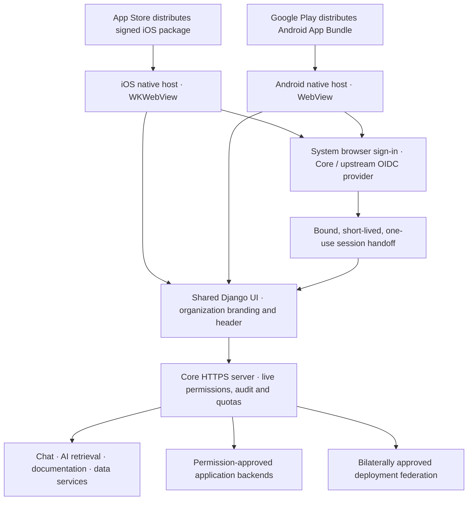

# iOS and Android architecture review

Review baseline: Core commit `e8b8f0f`, 10 October 2026. Implementation proceeds
through the [sequential delivery playlist](tasks/mobile-delivery.md). Only
MOBILE-01 is completed in this session.

## Decision and feasibility

Keep Django's HTML, CSS, JavaScript, organization branding, and shared header as
the single application UI. Add a small Swift/WKWebView host on iOS and a small
Kotlin/Android WebView host on Android. Native code supplies system-browser
authentication, verified links, safe navigation, device lifecycle, and push
notification integration. Business screens remain the same server-rendered UI
on both platforms and the web. System sign-in, permission prompts, keyboards,
and accessibility controls retain each operating system's behavior.

This is feasible, but the repository currently has neither native project nor
signed package. Reusing responsive HTML does not establish native authentication
or store readiness. A website-only wrapper risks rejection, particularly under
Apple's minimum-functionality rules; the planned authenticated app launcher,
verified app links, native notification delivery, and useful offline/reconnect
experience must be implemented and reviewed before submission. These features
improve the product; they do not guarantee acceptance.

Direct native WebViews suit the current architecture because Django produces
pages at request time. Capacitor remains an alternative if we later produce a
bundled frontend, but using its development `server.url` setting as a production
shortcut would not solve authentication or safely exposing plugins to remote
pages. React Native or Flutter would require a second screen implementation and
make the identical shared UI harder to maintain.

The App Store and Google Play distribute **signed native packages**, not the
Django application or its data. PostgreSQL, Gunicorn, workers, identity,
marketplace management, data fabric, AI retrieval, and applications remain on
an organization's existing server or Kubernetes deployment. Both native apps
connect to that same deployment over HTTPS. Remote applications continue running
where they are deployed. No cloud resources are purchased by this design.

## What the repository already supplies

| Area | Evidence | Mobile consequence |
| --- | --- | --- |
| Shared screens | `templates/identity/base.html`, Core Chat/AI templates | Reuse their rendered pages; no native copy of business screens. |
| Shared organization tools | `platform_services/assets/header.js` and `header.py` | Reuse apps, pins, account tools, Chat, branding and permission-filtered links. |
| Local and brokered identity | `identity/federation.py`, `identity/oauth.py`, `core/settings.py` | Core can authenticate locally or broker upstream OIDC. Code flow, S256 PKCE, exact redirects and token rotation already exist. |
| Public OAuth clients | `identity/tests/test_identity.py::test_public_client_uses_pkce_and_confidential_backend_introspection` | A native client can be public; the confidential backend remains separate. HTTPS redirect validation currently excludes arbitrary custom schemes. |
| First-party portal authentication | Django sessions, CSRF middleware, secure production cookies | A system browser and WebView do not reliably share cookies. A new bound handoff is required. |
| Service consumption | `platform_services/integration_api.py` and application backend adapters | Workload credentials and confidential client secrets stay on servers. Native apps must not copy them from deployment bundles. |
| Authorization | `identity/access.py`, environment/tag policies, application grants | Mobile must preserve live roles, tags, MFA evidence, purpose, application and deployment context. A client-side menu never grants access. |
| App marketplace | `platform_services/portal.py::marketplace`, `header.py::applications` | Purchasing/installing is administrator-only today; member app access comes from permission-filtered deployed links. A clearer shared member launcher is still needed. |
| Chat notifications | Chat workspace polling and browser notifications | These do not provide reliable iOS/Android background notification delivery. APNs/FCM adapters are required. |
| AI | `core_ai`, shared quota rules, data fabric | Retrieval already stays behind live authorization; generation remains inactive. Mobile does not introduce model keys or paid calls. |
| Build and release | `ci/pipeline.py`, manual `.github/workflows/pipeline.yml` | Existing CI builds the server. Native unsigned verification, signing and store packages need their own stages. |

## UI and native host contract

Start with one generic **Core Platform** binary per store. A user selects an
operator-approved deployment, signs in, and sees the organization's existing
name, logo, colors and permitted applications. Organization branding is cosmetic;
issuer, organization, service and deployment identifiers continue establishing
trust. Separate customer-branded binaries are a later distribution decision,
with their own store identifiers, ownership, review and possible fees.

The native host will:

- Load only an explicitly approved HTTPS Core origin. Configuration contains
  public origins and identifiers, never passwords, signing keys, workload
  credentials, confidential OAuth secrets, or AI provider keys. Release builds
  reject DEBUG, localhost origins and cleartext traffic.
- Distinguish Core, approved application origins, identity-provider browser
  destinations and ordinary external links. An administrator adding a header
  link does not authorize that destination to access native capabilities.
- Open sign-in in ASWebAuthenticationSession on iOS and an appropriate system
  browser/Custom Tabs flow on Android. Verified HTTPS callbacks use associated
  domains/App Links and exact registered paths. No blanket custom-scheme, CORS,
  `Origin: null`, or CSRF exception is introduced.
- Keep privileged native APIs out of arbitrary remote JavaScript. The default
  WebView exposes no general-purpose JavaScript-to-native bridge; any future
  narrowly scoped capability requires exact-origin validation, bounded input,
  and a separate security review. Unknown popups, downloads and cross-origin
  navigation open through approved system mechanisms or are rejected.
- Use one safe-area owner per page. Core's base page consumes screen insets;
  its header avoids applying them twice. An application embedding the header
  may let the component consume its own insets, or explicitly set its three
  `--core-header-inset-*` variables to zero when its page already does so.
- Clear private cached state on logout, account/deployment switch, revocation
  and foreground authorization failures. No sensitive offline database or
  service-worker response cache is planned for the initial release. A bundled
  connection-status page contains no organization data.
- Preserve accessible zoom, readable text, focus order, VoiceOver/TalkBack,
  Android Back behavior, small-screen navigation and keyboard reachability.
  Screen width and OS controls can differ; business screens use identical
  templates, assets and backend behavior.

MOBILE-01 adds `viewport-fit=cover`, safe-area CSS, phone form text at least 16px,
44px primary form controls, long-name wrapping and inset-aware header drawers.
The safe-area variables accept simulated values for browser geometry tests;
real devices must still verify their OS-provided insets. Chat keyboard layout,
admin tables, all application screens and accessibility are not yet fully audited.

## Authentication is the first backend gap

Native identity must be designed around existing Core authorization, not an
unrestricted conversion of an arbitrary application's access token into a Core
administrator session. MOBILE-02 will implement a **first-party mobile sign-in
transaction** with an explicitly registered public mobile client and approved
deployment context. Its acceptance criteria require:

1. A system-browser flow through Core, preserving local login or upstream OIDC
   and its verified `amr`, `acr`, issuer and authentication time. Native proof
   material remains outside webpage JavaScript.
2. State/nonce and S256 proof binding, exact issuer/client/callback/organization
   binding, a short expiry, atomic one-use redemption, and rejection of replay,
   wrong verifier, wrong organization, disabled client and revoked membership.
3. A native-only redemption operation that establishes an HttpOnly, Secure,
   same-origin WebView session. Cookies are installed through platform cookie
   APIs; credentials do not appear in URLs, localStorage, injected JavaScript,
   repository files or logs. Any callback code is an ephemeral proof-bound
   value, not a reusable session or bearer credential.
4. Explicit tenant/application context and live authorization on the resulting
   session. A third-party client's token cannot bootstrap a more privileged
   first-party Core session or silently change organizations. Account switching
   requires a newly authorized context.
5. CSRF-protected page mutations, session rotation, logout/revocation, verified
   MFA freshness and purpose constraints. Do not weaken existing secure-cookie,
   referrer, redirect or `Origin: null` rejection settings to accommodate a host.

Standalone applications keep their own OIDC/backend-for-frontend flow. Native
navigation to them needs a separately approved integration and browser session;
Core cookies are never copied to another origin. A Kubernetes-compatible app is
not automatically compatible with embedding, mobile layout or native features.

## Store and production requirements

Before publishing, both apps need stable bundle/package identifiers, version and
build numbers, icons, launch assets, screenshots, support and privacy URLs,
truthful privacy/data declarations, age/content ratings, account-deletion behavior,
review instructions and a synthetic review account. The backend and the permitted
sample app must be reachable by reviewers over production HTTPS. Laptop localhost
and this cloud workspace's private listener cannot serve as store-review hosting.

iOS additionally needs Xcode/macOS, the current submission SDK requirements,
appropriate entitlements, signing/provisioning, privacy manifests where required,
archive validation and App Store Connect/TestFlight work. Android needs a pinned
JDK/Gradle toolchain, current target SDK requirements, release AAB signing, secure
upload-key handling/Play App Signing, Data Safety and Play Console testing/release
work. Apple and Google account enrollment can involve fees; the human checks
current charges and performs those actions. Existing accounts may suffice.

If Chat ships, its user-generated content needs reporting, blocking, moderation
and a support/escalation process meeting applicable store rules. Existing groups,
participant permissions and notifications alone do not establish this. Account
deletion must distinguish leaving an organization from deleting an account and
handle data retention, federated copies and audit requirements accurately.
Do not claim HIPAA certification or other compliance from the existence of tags.

The initial binary and marketplace install flow remain free. Introducing paid
digital apps, subscriptions, AI credits or purchase links requires a separate
store-billing review before activation; enterprise distribution or organization
licensing is not a blanket exemption. No tracking SDK or provider key is added
for this foundation. New data sharing, analytics or model providers require
updated disclosures and appropriate consent.

Remote UI updates stay within the reviewed product's functionality and published
native capability contract. New native permissions/plugins require signed binary
releases and updated review/disclosures. Backend compatibility must support
older installed app versions through an explicit versioned contract.

## Human handoffs and financial boundary

Codex can edit, verify, commit, push and pull within GitHub/NorthCountryEngineer.
It will not spend money or act as the owner in Apple, Google, Firebase, a cloud
provider, a DNS/hosting service, an identity provider or another external account.
When a task actually requires such action, stop before it and provide the exact
human steps, expected non-secret result and resume phrase. Never request secrets
in chat, upload keys to Git, or treat a configuration toggle as financial approval.

The playlist supplies stage-specific handoffs. No enrollment, hosted runner,
store identifier reservation, account login, infrastructure purchase, provider
configuration, store upload or submission was performed for MOBILE-01. Existing
cloud setup is sufficient for its Python/Chromium checks; no environment-setting
write or new toolchain installation is needed.

## Verification and references

MOBILE-01 browser checks render the actual login, AI and Chat templates and load
the actual header component with synthetic local API fixtures. They verify
320/390/768/1280px layouts for login/AI, phone font/control sizes, preservation of
zoom, and header drawer bounds with simulated top/side/bottom insets and a shorter
viewport. They use no live accounts or customer database. Existing CSRF and
header authorization tests provide separate backend regression coverage.

These checks are Chromium checks, not Safari/WKWebView, Android WebView, device
keyboard, signing, store submission or store acceptance verification. This Linux
workspace has neither Xcode nor the Android SDK. Native verification remains in
the ordered tasks below.

Official references to recheck before implementing/submitting:

- [OAuth for native apps, RFC 8252](https://www.rfc-editor.org/rfc/rfc8252)
- [OAuth security best practice, RFC 9700](https://www.rfc-editor.org/rfc/rfc9700)
- [Apple WKWebView](https://developer.apple.com/documentation/webkit/wkwebview)
- [Apple authentication services](https://developer.apple.com/documentation/authenticationservices)
- [Apple review guidelines](https://developer.apple.com/app-store/review/guidelines/), especially user-generated content, minimum functionality, login services and privacy
- [Apple submission requirements](https://developer.apple.com/news/upcoming-requirements/)
- [Android WebView security](https://developer.android.com/privacy-and-security/risks/unsafe-uri-loading)
- [Android App Links](https://developer.android.com/training/app-links)
- [Google Play target API requirements](https://support.google.com/googleplay/android-developer/answer/11926878)
- [Google Play account deletion requirements](https://support.google.com/googleplay/android-developer/answer/13327111)
- [Capacitor configuration](https://capacitorjs.com/docs/config)

Public documentation requests were blocked by this environment's proxy during
the review. Links are references, not evidence of freshly verified store fees,
submission deadlines, SDK versions or account-specific tester requirements.
The relevant future task must confirm current rules before locking native build
versions or beginning submission.
