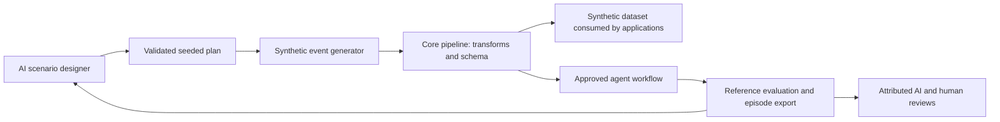

# Core Training: AI-first simulated data and evaluations

Core Training is a marketplace core service managed by the central platform.
Applications can consume it wherever deployed, using the normal Core URL and
integration client. Each simulation runs under an approved agent account. AI
agents can author scenarios, run them, inspect results, submit evaluations, and
revise cases through provider-neutral function tools. Reference scores are kept
separate from AI judgments and human reviewer feedback.



The built-in generator runs locally with no model-provider dependency. An
application connects its chosen AI provider to the tool contract; no paid model
calls or fine-tuning jobs are activated by installing or running Core Training.
This is an agent behavior/data simulation and evaluation harness. Its exported
episodes can feed an application's own learning or model-training adapter.

## First scenario

1. Open **Marketplace** and install **Core Training** if it is not already part of
   the organization workspace. Its embedded instance is monitored by the core
   worker, like other core services.
2. Create a dataset with classification **Synthetic / training** and a pipeline
   into it. Classification is immutable; operational datasets cannot be selected
   as training destinations. The worker also checks this boundary on every event.
3. Install **Training Coordinator** from the agent marketplace, or use an existing
   agent account. Approve a consuming application and a non-production environment.
   Give its role the appropriate Core Training permissions (`training-run`,
   `training-read`, `training-manage`, `training-evaluate`) and Core Data
   `data-write`. AI clients that read the dataset also need `data-read`.
4. Optionally choose a workflow and grant the coordinator `workflows-run` on
   Core Workflows. Approve each participating workflow agent for the same
   application, environment, and task, with `agents-run` and its tool permissions.
   Every publication target must be synthetic. Training workflows use inspect,
   select, publish, and rules over those tools; chat/external side effects are
   excluded from this harness.
5. In UAT, approve an expiring task and list **every** input/output dataset UUID in
   its resource allowlist. Select that task on all participating agent approvals.
   Account, role, service, task, and dataset permission tags remain enforced.
6. Open **AI training harness**, create the scenario, and select its pipeline,
   optional workflow, and agent approval. Set its goal and plan, then run it.
   The panel shows events, reference scores, agent attribution, and AI/human
   reviewer feedback. It can cancel a run and pending child workflow steps.

For example, a pipeline renames `subject` to `title`, and its synthetic dataset
schema requires a string `title`. This plan produces three valid reports and an
expected invalid-title rejection:

```json
{
  "seed": 42,
  "cases": [
    {
      "name": "nominal", "count": 3,
      "fields": {"subject": {"kind": "sequence", "prefix": "Simulated report "}},
      "expected_ingest": "accept",
      "assertions": [{"field": "title", "operator": "equals_input", "input_field": "subject"}]
    },
    {
      "name": "invalid-title", "count": 1,
      "fields": {"subject": {"kind": "constant", "value": 123}},
      "expected_ingest": "reject"
    }
  ]
}
```

Generators support constants, bounded choices, integers/numbers, booleans,
sequences, UUIDs, timestamps, and synthetic `example.test` email addresses.
Generators never fetch records from operational datasets or execute model-proposed
code/URLs. Plans contain at most 20 cases and 200 events, bounded field sizes, and
finite JSON values. Generate synthetic values deliberately; do not put real record
contents into scenario constants or goals.

Assertions support `exists`, `equals`, `equals_input`, and `type` on dotted object
paths. Rejection expectations count as passing only when validation rejects the
event. Accepted events are scored against their final pipeline/workflow output.
A run can complete with failed assertions; configuration/authorization failures
use the separate `failed` state. Scores include totals, pass rate, and per-case
counts. AI/reviewer feedback never replaces these scores.

## AI tools and application integration

Applications discover `training_url` in their integration document. Their trusted
host exchanges an approved binding for the coordinator's own short-lived token:

```python
from core_client import CoreClient

host = CoreClient.from_environment()
agent = host.agent_client(binding_id, environment="uat", task_id=task_id)
tools = agent.training_tool_definitions()
# Pass these tool descriptions to your chosen model provider.
# Dispatch its proposed call through the trusted host:
created = agent.invoke_training_tool("core_training_create",
    {"goal": proposed_goal, "plan": proposed_plan},
    scenario_slug="acceptance-training", scenario_name="Acceptance training",
    pipeline="synthetic-input", workflow="approved-workflow")
scenario_id = created["scenario"]["id"]
started = agent.invoke_training_tool("core_training_run", {},
    scenario_id=scenario_id, request_id=host_generated_request_id)
result = agent.invoke_training_tool("core_training_result", {}, run_id=started["run_id"])
```

Tool arguments contain the proposed goal/plan or feedback. Agent identity,
application, environment, task, pipeline, workflow, selected scenario/run, and
request IDs come from the trusted host or approved scenario. Model arguments
cannot change those boundaries. Core validates every plan before execution.
The portable SDK requires `core_client.py`, `training_contract.py`, and `requests`;
it has no Django/model-provider dependency on the application side.

`core_training_revise` takes a new goal/plan; the host supplies scenario ID and
expected revision. Stale revisions return a conflict. Scenario routing is
immutable. `core_training_feedback` takes `verdict` (`pass`/`fail`/`review`),
`rationale`, and optional short suggestions, with host-selected run and request ID.
Feedback is idempotent and records the actual agent UUID. Human reviewers can add
feedback through the panel. Agent roles permit separate designer, runner, reader,
and evaluator responsibilities.

Applications consume simulation records through the existing Core Data cursor API.
Every record includes `synthetic: true` and `training_run_id`; workflow publications
retain this provenance too. Classification is stored independently of record
contents, so an input cannot remove its synthetic marker. Applications must
respect these markers when routing events or displaying simulation results.

Export provider-neutral episodes without starting a model training job:

```python
import json

with open("simulation-episodes.jsonl", "w") as output:
    for episode in agent.training_episodes(started["run_id"]):
        output.write(json.dumps(episode) + "\n")
```

Each episode carries input, output, evaluation, synthetic marker, run/scenario IDs,
seed, generator version, and coordinating agent identity. Dataset conversion and
any paid training service remain explicit application integrations.

## API and worker behavior

All paths are relative to `/api/platform/v1`. Use an application or agent Bearer
credential, except AI scenario creation which requires the agent's own account.

| Endpoint | Permission |
| --- | --- |
| `GET /training/scenarios/` | `training.read` |
| `POST /training/scenarios/create/` | `training.manage`, agent account |
| `POST /training/scenarios/<UUID>/update/` | `training.manage`, current revision |
| `POST /training/scenarios/<UUID>/runs/` | `training.run` and required tool/data permissions |
| `GET /training/runs/<UUID>/` | `training.read` |
| `POST /training/runs/<UUID>/cancel/` | `training.manage` |
| `POST /training/runs/<UUID>/feedback/` | `training.evaluate` |

Run submission accepts only `request_id`; its routing and task come from the
scenario. Results page by event index (`after=-1`, `limit=1..100`). Applications can
run only scenarios whose agent is approved for their installation; agents can
manage/run only scenarios bound to their exact account approval. Native admins
must satisfy the same resource/tag policy. Feedback is limited to 100 entries
per run; organizations can have at most eight active simulations.

The existing `manage.py core_worker` fairly services workflow and training queues.
Runs snapshot plans, goals, pipeline transforms/schema, workflow tool definitions,
and agent approvals. Seeded samples are reproducible under generator version 1.
The current dataset schema is also enforced after schema changes. Checkpoints,
leases, and stable per-event request IDs prevent duplicate writes on recovery.
The worker rechecks submitter authority, every agent's role/tag grants, account
state, synthetic classification, task scope, and expiration before side effects.
Cancellation and parent failures stop pending child workflow execution. Previously
committed synthetic records remain available with their provenance.

Security audits store identities and decision metadata, not event bodies or
feedback text. Result access inherits pipeline, agent, workflow, and destination
tags, including tags added after submission. No model prompt grants permission.
Existing organizations receive the core service with empty application grants;
no agent permissions or training scenarios are automatically enabled.

## Verification

```sh
CORE_DEBUG=1 .venv/bin/python manage.py test platform_services.tests.test_training
```

The tests exercise actual HTTP account exchange and AI tools, real pipeline and
workflow execution, remote consumption/export, expected rejections, reference
scores, snapshots, leases, cancellation, UAT expiration, role/tag revocation,
tenant isolation, operational-data restrictions, and attributed feedback.
